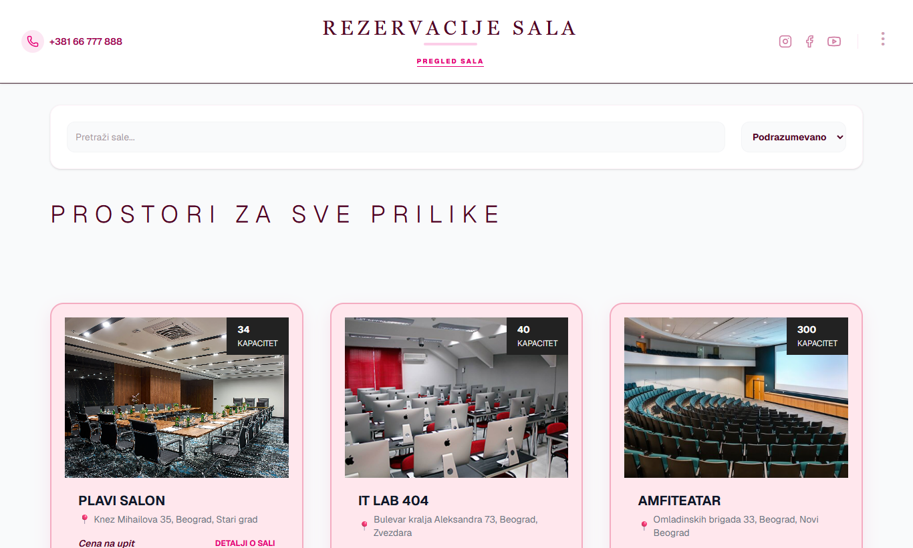
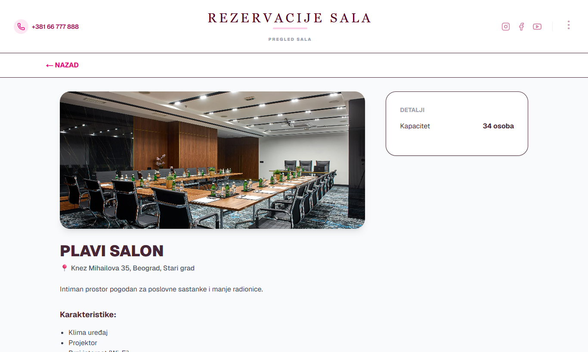
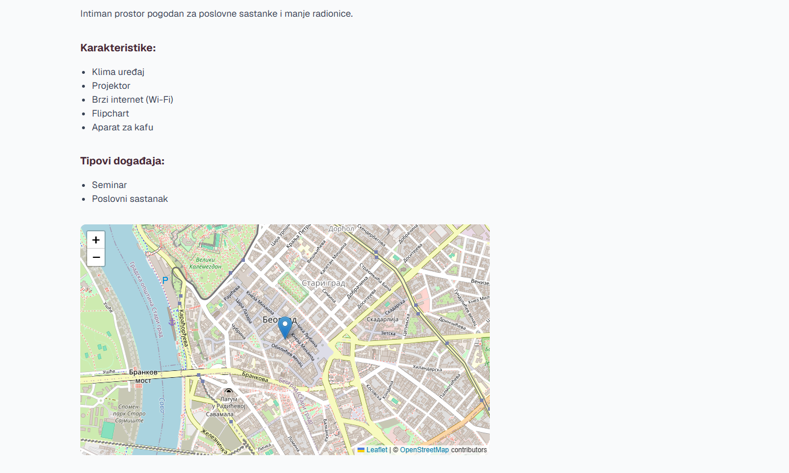
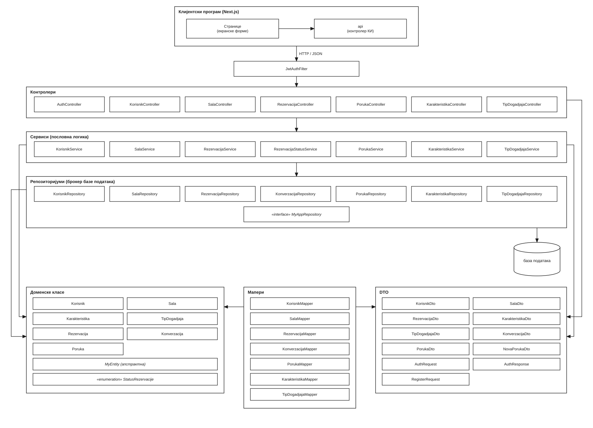
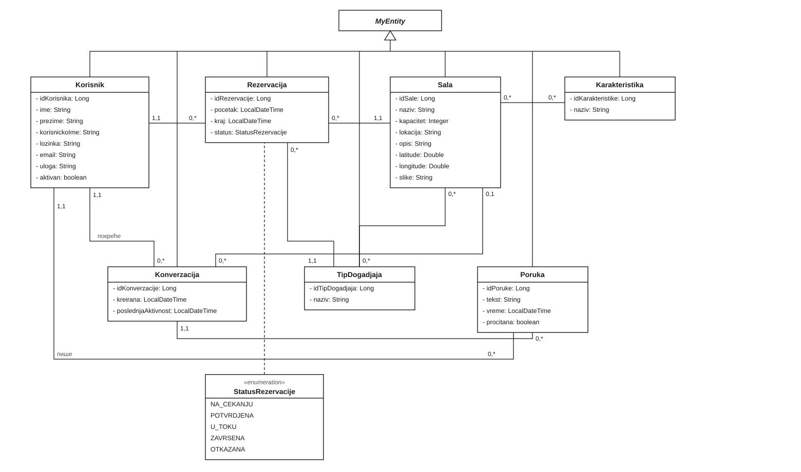

# Room Booking System in a Jakarta EE Environment

A full-stack web application for booking rooms such as classrooms, amphitheatres, meeting and conference rooms. **Visitors** browse and search the available rooms, **users** book time slots and track their reservations, and **administrators** manage rooms, confirm reservations and handle users.

Built with **Spring Boot 4** on Jakarta EE (REST API, Spring Security + JWT, JPA/Hibernate, MySQL) and **Next.js** with TypeScript.

> Bachelor's thesis at the Faculty of Organizational Sciences, University of Belgrade (2026), Software Engineering module.
> Original title: *Softverski sistem za rezervaciju sala u Jakarta EE okruženju*.



## Why this project?

Rooms are a shared resource with limited capacity, equipment and time. When bookings are kept in spreadsheets or e-mails, the same room easily gets booked twice and nobody outside the office knows what is free. This system:
- makes rooms and their availability **publicly visible**;
- **checks for conflicts automatically**, so a room can never be double-booked;
- reduces administrative work by tracking every reservation from request to completion.

## Features

**Visitors**
- Browse all rooms, search by name and filter them.
- Open a room's details: capacity, equipment, the event types it supports and its location on an interactive map.
- Register (a verification e-mail is sent) and log in.

**Users**
- Book a room for a time slot. The server rejects any request that overlaps an existing reservation.
- Track their own reservations and cancel them.
- Send questions about a room to the administrator and follow the conversation.

**Administrators**
- Add, edit and delete rooms, room features and event types.
- Review all reservations and confirm pending ones.
- Search users and answer their messages.
- See booking statistics in charts.

**Reservation lifecycle**

```
NA_CEKANJU (pending) → POTVRDJENA (confirmed) → U_TOKU (in progress) → ZAVRSENA (finished)
         └──────────────→ OTKAZANA (cancelled)
```

A scheduled job runs every minute and moves confirmed reservations to *in progress* and then to *finished* as their time passes.

## Screenshots

| Room details | Location on the map |
|---|---|
|  |  |

## Technical highlights

- **No double bookings, even under concurrency.** Before checking for overlaps, the room row is locked with a pessimistic write lock (`PESSIMISTIC_WRITE`), so two simultaneous requests for the same slot cannot both pass the check. The losing request gets `409 Conflict`.
- **Stateless security.** JWT authentication with role-based access (`ADMIN`, `KORISNIK`) enforced per endpoint in `SecurityConfig`; passwords hashed with BCrypt.
- **E-mail verification** of new accounts through verification tokens and Spring Mail.
- **Clean layering.** Controllers work only with DTOs, mappers convert between DTOs and entities, and a global exception handler turns domain exceptions into consistent HTTP responses.
- **Tested.** 114 unit and integration tests for controllers, services and repositories, written with JUnit 5 and Mockito (repository tests run on an in-memory HSQLDB).
- **Designed before coded.** Developed with the simplified Larman method: use cases, system sequence diagrams, system operation contracts, a conceptual and relational model, and the final architecture (see [`docs/diagrams`](docs/diagrams)).

## Tech stack

| Layer | Technologies |
|---|---|
| Backend | Java 25, Spring Boot 4, Jakarta EE (JPA, Bean Validation), Spring Security, JJWT, Spring Mail, Lombok, Maven |
| Database | MySQL / MariaDB |
| Frontend | Next.js 16, React 18, TypeScript, Tailwind CSS, Leaflet (maps), Recharts (charts) |
| Testing | JUnit 5, Mockito, Spring Security Test, HSQLDB |

## Architecture

```
Next.js client (localhost:3000)
   │  fetch + JWT in the Authorization header
   ▼
REST API (Spring Boot, localhost:8080/api)
   Controller  →  Service  →  Repository (JPA EntityManager)  →  MySQL
       │            │
      DTOs  ◄── Mapper ──►  Entities
   JwtAuthFilter → SecurityContext → role checks per endpoint
   RezervacijaStatusService (@Scheduled) → updates reservation statuses
```



Domain model: a `Sala` (room) has `Karakteristike` (features) and supports `TipoviDogadjaja` (event types); a `Korisnik` (user) makes a `Rezervacija` for a room and event type; a `Konverzacija` holds the `Poruke` (messages) between a user and the administrator about a room.



> Diagram labels are in Serbian, the language of the thesis. System sequence diagrams for the main use cases are in [`docs/diagrams/sequence`](docs/diagrams/sequence).

## Getting started

### Prerequisites
- Java 25 (JDK)
- Node.js 20+
- MySQL or MariaDB (for example the one bundled with XAMPP)

### 1. Backend

```bash
cd rezervacije/rezervacije
cp src/main/resources/application.properties.example src/main/resources/application.properties
# fill in the database password, a JWT secret (64+ random characters) and SMTP credentials
./mvnw spring-boot:run
```

The database `rezervacije_sala` must exist; its tables are created automatically on first start (`ddl-auto=update`). The API runs on `http://localhost:8080/api`. A free [Mailtrap](https://mailtrap.io) sandbox works for testing verification e-mails.

### 2. Frontend

```bash
cd rezervacije-front
npm install
npm run dev
```

The app opens at `http://localhost:3000`. The API address is set in `.env` (`NEXT_PUBLIC_API_URL`).

### Tests

```bash
cd rezervacije/rezervacije
./mvnw test
```

## REST API overview

| Resource | Endpoints | Access |
|---|---|---|
| Auth | `POST /api/auth/register`, `POST /api/auth/login`, `GET /api/auth/verify` | public |
| Rooms | `GET /api/sale`, `GET /api/sale/{id}`, `GET /api/sale/pretraga` | public |
|  | `POST /api/sale`, `PUT /api/sale/{id}`, `DELETE /api/sale/{id}` | admin |
| Features, event types | `GET /api/karakteristike`, `GET /api/tipovi-dogadjaja` | public |
|  | `POST` on both | admin |
| Reservations | `POST /api/rezervacije`, `GET /api/rezervacije/moje` | user |
|  | `GET /api/rezervacije`, `PUT /api/rezervacije/potvrdi/{id}` | admin |
|  | `DELETE /api/rezervacije/{id}` | user, admin |
| Messages | `GET/POST /api/poruke`, `GET/POST /api/poruke/{id}`, `GET /api/poruke/neprocitane` | user, admin |
| Users | `GET /api/korisnici`, `GET /api/korisnici/pretraga` | admin |

## Project structure

```
├── rezervacije/rezervacije/          Spring Boot application
│   └── src/main/java/njt/NJT_Projekat/
│       ├── config/                   security and scheduling configuration
│       ├── controller/               REST controllers
│       ├── dto/                      request and response objects
│       ├── entity/                   JPA entities and enums
│       ├── exception/                domain exceptions and global handler
│       ├── mapper/                   DTO ↔ entity mappers
│       ├── repository/               data access (EntityManager)
│       ├── security/                 JWT service and filter
│       └── service/                  business logic
├── rezervacije-front/                Next.js client
│   └── src/ app/ (pages), components/, lib/ (API client, types)
└── docs/diagrams/                    architecture, domain model, sequence diagrams
```

## Author

**Iva Perić** · [LinkedIn](https://www.linkedin.com/in/iva-peric-se) · [GitHub](https://github.com/Iva242)
